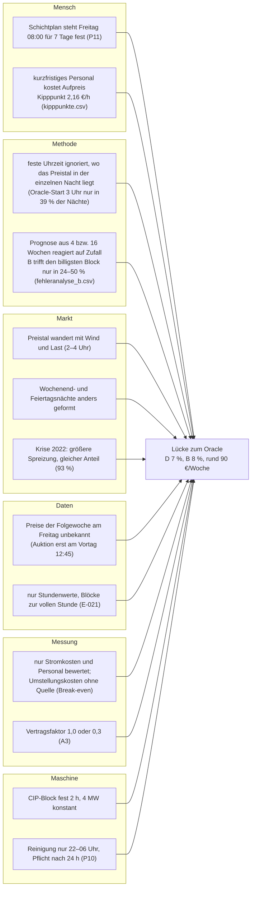

# Ishikawa: Warum bleibt Ersparnis gegenüber dem Oracle liegen?

<!-- KI: Claude, Zweck: Ursache-Wirkungs-Diagramm nach Operational Intelligence Teil E (Phase 4), geprüft von Caro (R4) -->

Owner: R4 (Caro). **Wirkung:** Die feste Regel D (3 Uhr) holt im Test 93 % des Oracle-Werts, B_16 94 %, die Prognose B 92 % (`ergebnisse/ki_strategien.csv`). Die Lücke beträgt rund 80–110 € pro Woche. Woher kommt sie? Belegte Ursachen sind mit Datei markiert, die übrigen sind Hypothesen.

**Lesart:** Die Hauptursache ist **Daten × Mensch**: Am Freitag sind die Preise der Folgewoche unbekannt, und der Schichtplan legt sich trotzdem für 7 Tage fest. Eine bessere Prognose hebt die Lücke nicht: B und B_16 liegen nicht signifikant über D (H0b, E-049). Schließen ließe sich die Lücke nur durch Tagesplanung (C), und die lohnt nur, wenn kurzfristiges Personal weniger als rund 2 € pro Stunde Aufpreis kostet (H0c).
