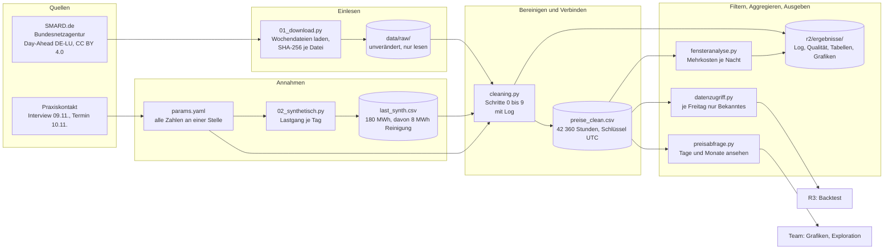
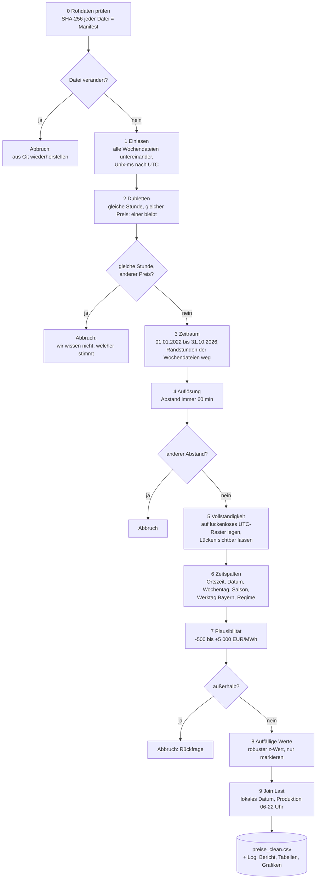
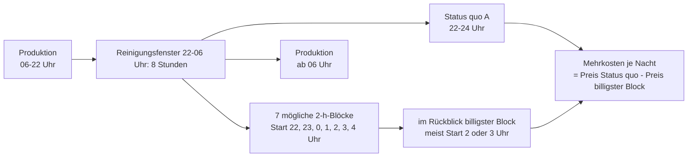
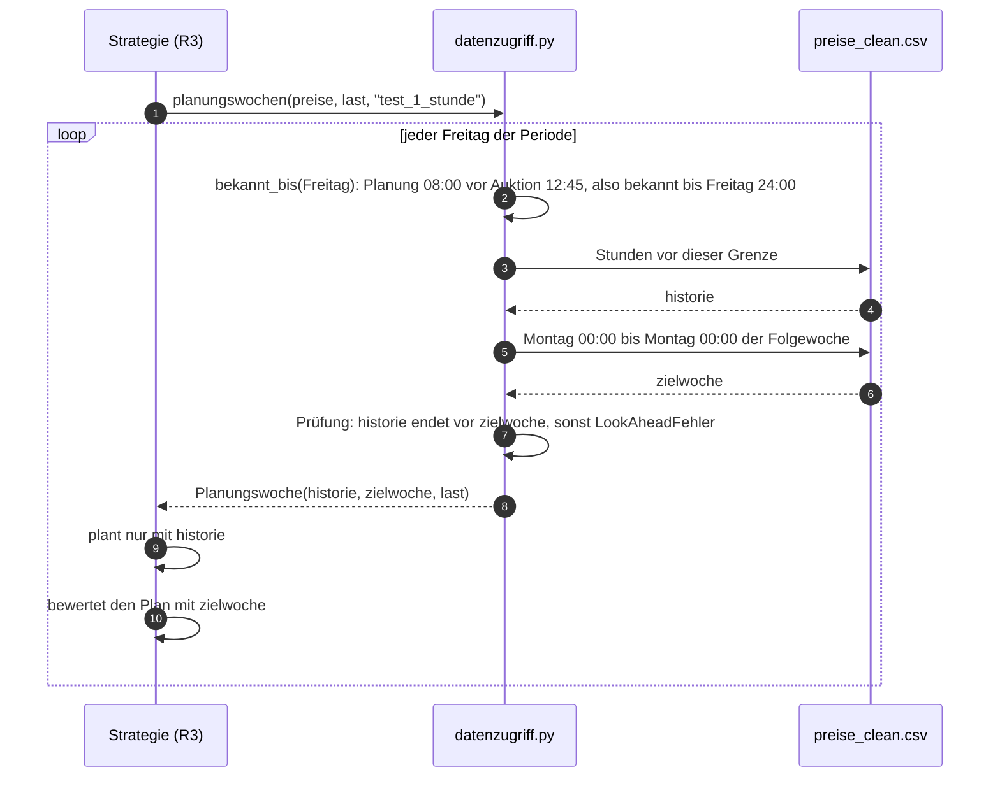
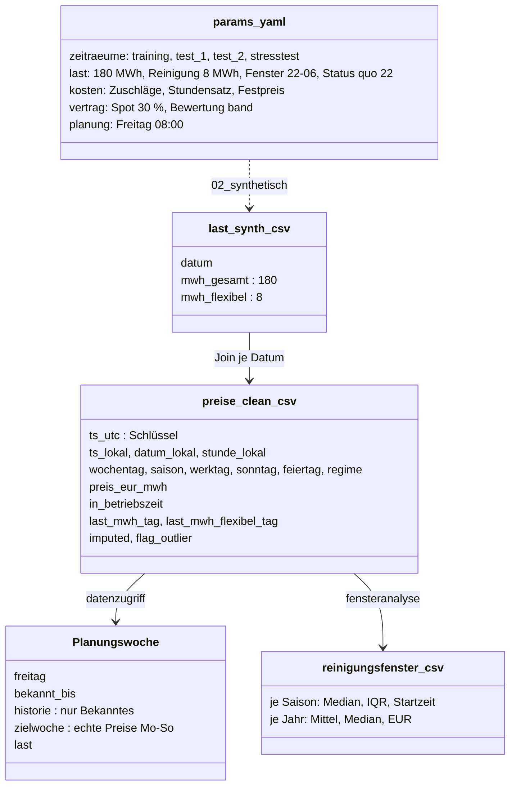

# Architektur R2: was passiert mit den Daten, und warum

<!-- KI: Claude, Zweck: Diagramme und Erklärung der R2-Pipeline für Verteidigung und Team, geprüft von Max (R2) durch Nachvollziehen am Code -->

Stand 10.11.2026, Owner R2 (Max). Die Diagramme zeigt GitHub direkt als Grafik an; `python src/build_board.py` übernimmt sie ins Board `r2/ergebnisse/board.html`. Jeder Kasten nennt die Datei, in der es passiert, damit man vom Bild direkt in den Code springen kann.

**Einordnung nach Kursmaterial (Statistisches Grundlagenwerk Teil 4):** R2 ist die Stufe **deskriptiv** („Was ist passiert, und warum?“) und im DMAIC-Zyklus die Phase **Measure** (Daten sammeln, Baseline festlegen). Prädiktiv wird es mit den Prognose-Strategien von R3, präskriptiv mit der Empfehlung von R4. Leitsatz aus dem Kurs: „ohne saubere Beschreibung keine belastbare Prognose“. Die Pipeline folgt dem Prinzip „Workflow statt Formelkette: jeder Schritt ist ein Knoten“.

---

## 1. Der Workflow im Überblick

Jeder Knoten ist ein Skript, jeder Pfeil eine Datei. Ein Befehl (`python src/run_all.py`) führt alles in dieser Reihenfolge aus; das macht die Arbeit reproduzierbar (Sperrkriterium).

**Wie man es liest:** Links kommen die Daten herein, rechts gehen sie an die Nachbarpakete. Die Zylinder sind Dateien im Repo. Kein Skript schreibt in `data/raw/`; wer das versucht, fällt beim nächsten Lauf durch die Prüfsumme.

---

## 2. Die Bereinigung Schritt für Schritt (`src/cleaning.py`)

Jeder Schritt schreibt eine Zeile in `r2/ergebnisse/cleaning_log.md`: Regel, Zeilen vorher, Zeilen nachher, betroffene Zeilen, Begründung. Die Rauten sind Prüfungen, die den Lauf **abbrechen**, statt still etwas zu reparieren.

### Die Regeln und warum

| Schritt | Regel | Warum so | Verworfen | Beleg |
| --- | --- | --- | --- | --- |
| 0 | SHA-256 jeder Rohdatei muss zum Manifest passen | beweist, dass niemand die Rohdaten verändert hat (Datenherkunft, Sperrkriterium) | Rohdaten ungeprüft lesen | E-009, `data/raw/manifest.csv`, Test `test_rohdaten_unveraendert` |
| 1 | Zeitstempel als UTC aus SMARDs Millisekunden | in UTC hat jede Stunde genau einen Namen, auch bei der Zeitumstellung | Ortszeit als Schlüssel (mehrdeutig) | E-026 |
| 2 | exakte Dubletten: eine bleibt; widersprüchliche: Abbruch | eine Kopie ist harmlos, zwei verschiedene Preise für dieselbe Stunde kann man nicht auflösen | stillschweigend den ersten Wert nehmen | E-029, Test in `tests/test_cleaning.py` |
| 3 | Zeitraum 01.01.2022 bis 31.10.2026 (deutsche Zeit), halboffen | SMARD liefert ganze Wochen; die Randtage gehören nicht zum Untersuchungszeitraum | — | `r2/ergebnisse/cleaning_log.md` Schritt 3 |
| 4 | Abstand zweier Zeitstempel immer 60 min | nur Stundenwerte; ab 01.10.2025 der SMARD-Stundenwert (Mittel der 4 Viertelstunden) | eigene Mittel aus 15-min-Daten | E-021, E-028 |
| 5 | erwartetes UTC-Stundenraster, fehlende Stunden als leere Zeile, `imputed` = False | Lücken sollen sichtbar sein, nicht erfunden; Ergebnis: 0 Lücken | Lücken interpolieren | E-013 |
| 6 | Ortszeit, Datum, Wochentag, Saison, Werktag (Feiertage Bayern), Regime aus UTC abgeleitet | Schichten folgen der Uhr im Werk; März-Tage haben 23, Oktober-Tage 25 Stunden, nichts wird gemittelt | doppelte Oktober-Stunde mitteln | E-026 (revidiert E-010, E-011), E-014 |
| 7 | Preis zwischen −500 und +5 000 €/MWh, sonst Abbruch | technische Preisgrenzen der Börse (SDAC); negative Preise und Spitzen sind echte Auktionsergebnisse | Spitzen kappen | E-029, Quellen in `r2/docs/datenaufbereitung.md` |
| 8 | `flag_outlier`, wenn Betrag des modifizierten z-Werts > 3,5 im Vergleich mit gleichem Jahr, Monat und Uhrzeit | Median und MAD lassen sich von Ausreißern nicht verziehen; Ergebnis: 1 827 Stunden (4,3 %) markiert, **nichts gelöscht** | ±3 Standardabweichungen, IQR-Löschregel | E-025, Iglewicz & Hoaglin 1993 |
| 9 | Last je Tag über das lokale Datum anhängen; `in_betriebszeit` = 06–22 Uhr | ein Lastwert je Tag; die Nacht 22–06 Uhr ist das Reinigungsfenster | — | E-024, E-033 |

**Wichtig für die Verteidigung:** `flag_outlier` vergleicht mit dem ganzen Monat, also auch mit Stunden, die am Planungsfreitag noch in der Zukunft lagen. Deshalb ist die Spalte nur zur Beschreibung da, und `datenzugriff.py` entfernt sie, bevor eine Strategie die Daten sieht.

---

## 3. Der Fall: Reinigung in der Nacht

Seit dem Termin vom 10.11.2026 (K-008) ist der verschiebbare Prozess die Reinigung (CIP): 4 MW für 2 Stunden = 8 MWh pro Nacht. Sie darf irgendwo zwischen Produktionsende 22 Uhr und Produktionsbeginn 6 Uhr liegen. Heute läuft sie (Annahme, E-031) direkt um 22 Uhr.

- **Eine Nacht heißt nach dem Tag, an dem sie beginnt:** Die Nacht 2025-03-07 läuft von Freitag 22:00 bis Samstag 06:00. So steht es auch in `last_synth.csv`: Der Wert eines Tages gilt für die Reinigung danach.
- **Echte Stunden:** In der März-Nacht fehlt 02:00 (7 Stunden), in der Oktober-Nacht gibt es 02:00 zweimal (9 Stunden). Ein Block sind immer 2 echte Stunden (E-036).
- **Kennzahl (E-037):** Mehrkosten des Status quo gegenüber dem billigsten Block, in €/MWh. Das ist ein **Rückblick mit bekannten Preisen**, also die Obergrenze des Flexibilitätswerts (Oracle C), keine Strategie.

---

## 4. Ein Planungsfreitag im Backtest (`src/datenzugriff.py`)

So bekommt R3 die Daten. Der Kern: Die Strategie sieht nur `historie`; erst danach wird mit `zielwoche` nachgerechnet.

**Warum ein eigenes Modul:** Würde jede Strategie die Datumsgrenze selbst ziehen, könnte eine sie falsch setzen, und das Ergebnis sähe zu gut aus. So gibt es die Grenze genau einmal, und ein Test prüft sie für alle Freitage (`test_kein_look_ahead_in_allen_planungswochen`). Ein zweiter Test baut absichtlich eine falsche Grenze ein und erwartet den Abbruch (`test_look_ahead_wird_erkannt`).

**Unterschied zu `preisabfrage.py`:** Die Abfrage zeigt jeden Tag der Vergangenheit, ohne Grenze. Sie ist zum Anschauen da, nie für Strategien (A-011).

---

## 5. Dateien und ihre Spalten

Jede Spalte mit Einheit, Quelle und Wertebereich: `docs/codebook.md`.

---

## 6. Wie es abgesichert ist

| Prüfung | Was sie zeigt | Wo |
| --- | --- | --- |
| Prüfsumme je Rohdatei | Rohdaten unverändert | `tests/test_pipeline.py::test_rohdaten_unveraendert` |
| Spalten, Typen, lückenloses Raster, keine Dubletten | die Datei hält, was das Codebook verspricht | `tests/test_cleaning.py` |
| Ausreißer nur markiert | kein Preis wurde verändert | `test_ausreisser_nur_markiert_nichts_veraendert` |
| 23-, 24-, 25-Stunden-Tage | Zeitumstellung korrekt | `test_lokale_tage_23_24_25_stunden` |
| kein Look-ahead an allen Freitagen | Backtest ist fair | `test_kein_look_ahead_in_allen_planungswochen` |
| Nacht über Mitternacht, Umstellungsnächte | Kennzahl rechnet mit echten Stunden | `tests/test_fensteranalyse.py` |
| unsinnige Parameter werden abgelehnt | Tippfehler in `params.yaml` fallen sofort auf | `test_last_unsinnige_parameter_werden_abgelehnt` |
| Gegenproben | die Tests würden Fehler finden | Tagebuch K-006, K-009 (absichtlich eingebaute Fehler, Tests rot) |

Alle Tests: `pytest tests/` (51, Stand 10.11.2026).

---

## 7. Was R2 nicht entscheidet

- **Wann** gereinigt wird: Strategien von R3.
- Ob sich die Verschiebung **nach Kosten lohnt**: R4 (Personal, Zuschläge, Umstellungskosten).
- Die **Sensitivitätsrechnung** (K2 Stufe 5) ist R2, braucht aber für den realisierten Wert den Backtest von R3; siehe `r2/docs/sensitivitaet_plan.md`.
