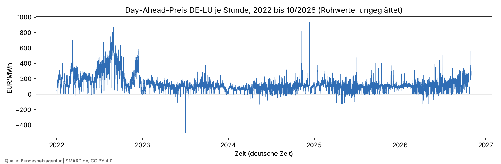
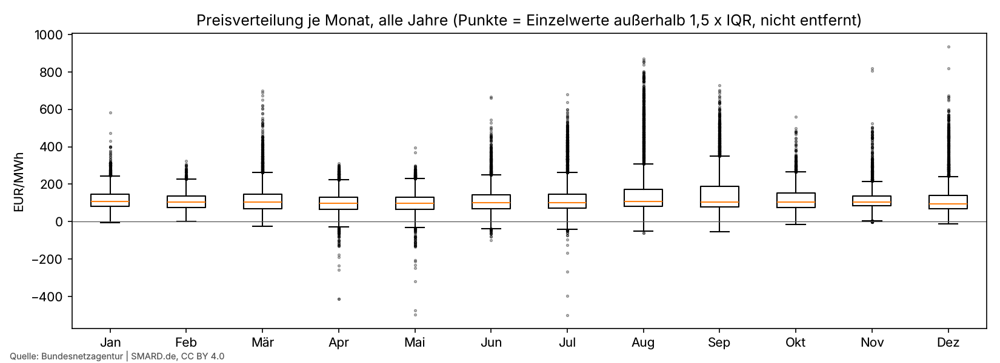
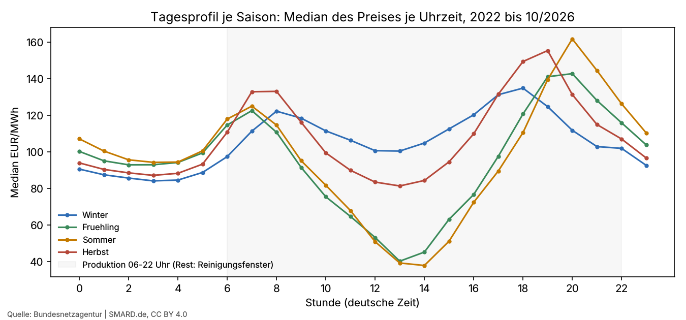

# Datenqualität (erzeugt)

Erzeugt von `r2/src/cleaning.py`. Methode und Begründung: `r2/docs/datenaufbereitung.md`. Schritte und Zählungen: `cleaning_log.md`.

## Überblick

- Stunden (UTC): 42360 von 31.12.2021 23:00 bis 31.10.2026 22:00 UTC
- Lücken: 0 · imputiert: 0 · auffällig markiert: 1827 (4.3 %)
- Stunden mit negativem Preis: 1862 (4.4 %)
- Zeitumstellungstage: 10 (je Jahr ein Tag mit 23 und einer mit 25 Stunden, immer sonntags; 02:00 bis 03:00 Uhr liegt außerhalb der Produktion, aber im Reinigungsfenster 22–06 Uhr: diese Nächte haben 7 bzw. 9 Stunden, Tagebuch E-036)

## Kennzahlen je Jahr (EUR/MWh)

| jahr | stunden | mittel | median | q25 | q75 | min | max | anteil_negativ_pct | iqr |
| --- | --- | --- | --- | --- | --- | --- | --- | --- | --- |
| 2022 | 8760 | 235.45 | 208.34 | 134.2 | 310.08 | -19.04 | 871.0 | 0.79 | 175.88 |
| 2023 | 8760 | 95.18 | 98.02 | 75.88 | 122.12 | -500.0 | 524.27 | 3.44 | 46.24 |
| 2024 | 8784 | 78.51 | 79.59 | 55.56 | 101.34 | -135.45 | 936.28 | 5.2 | 45.78 |
| 2025 | 8760 | 89.32 | 92.43 | 71.09 | 114.14 | -250.32 | 583.4 | 6.54 | 43.05 |
| 2026 | 7296 | 114.0 | 115.76 | 82.83 | 151.12 | -499.0 | 697.31 | 6.33 | 68.29 |

Je Monat und Saison: `tables/kennzahlen_monat.csv`, `tables/kennzahlen_saison.csv`; Tagesprofil: `tables/tagesprofil_saison.csv`.

## Grafiken

Quelle der Preise: Bundesnetzagentur | SMARD.de, CC BY 4.0. Grafiken zeigen Rohwerte, nichts geglättet.
